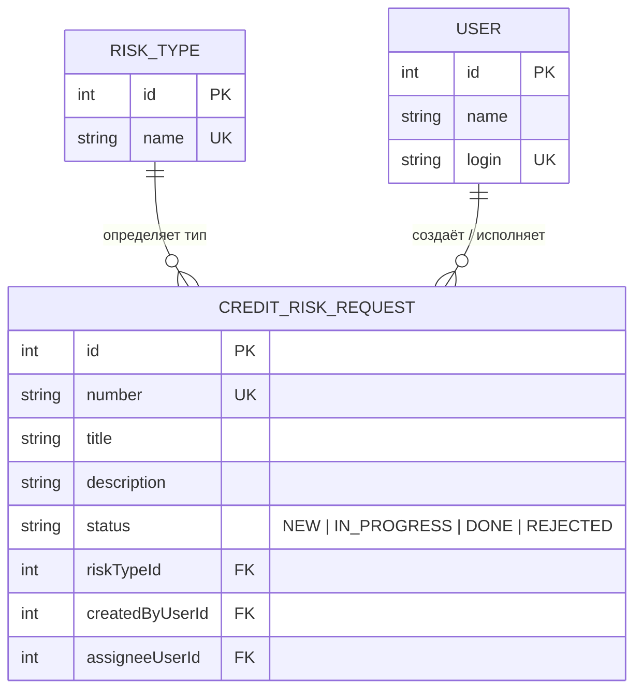

# Модель данных

## Словарь проекта

| Термин (исходный) | Термин проекта | Комментарий |
|---|---|---|
| Ticket | CreditRiskRequest | Заявка на оценку кредитного риска |
| User | User | Пользователь системы |
| RiskType | RiskType | Справочник типов риска |
| Site | Site | Площадка / объект (уточнить в домене) |

## ER-модель

## Справочник статусов

| Значение | Описание |
|---|---|
| `NEW` | Создана, не назначена |
| `IN_PROGRESS` | В работе у исполнителя |
| `DONE` | Завершена |
| `REJECTED` | Отклонена |

## Проверка 3НФ

Третья нормальная форма (3НФ) означает, что таблица уже соответствует первой и второй нормальным формам, а каждый неключевой атрибут зависит только от ключа, всего ключа и ничего, кроме ключа. Иными словами, в таблице не должно быть транзитивных зависимостей между неключевыми полями. Для данной модели это достигается разделением пользователей, типов риска и заявок на отдельные сущности. В заявке хранятся внешние ключи на пользователя и тип риска, а не повторяются их имена и описания. Благодаря этому изменение названия типа риска или имени пользователя не требует обновления множества заявок.

### Таблица `RISK_TYPE`

| Атрибут | Зависимость |
|---|---|
| `id` | PK |
| `name` | зависит от `id` |

- **1НФ**: все атрибуты атомарны, первичный ключ задан.
- **2НФ**: первичный ключ простой, поэтому частичных зависимостей от его части нет.
- **3НФ**: неключевой атрибут `name` зависит непосредственно от `id`; транзитивных зависимостей нет.

**Вывод:** таблица находится в 3НФ.

### Таблица `USER`

| Атрибут | Зависимость |
|---|---|
| `id` | PK |
| `name` | зависит от `id` |
| `login` | зависит от `id`, уникален (UK) |

- **1НФ**: все поля содержат атомарные значения, первичный ключ задан.
- **2НФ**: первичный ключ простой, все неключевые атрибуты зависят от него целиком.
- **3НФ**: имя и логин хранятся как атрибуты пользователя и не определяют друг друга. Логин является альтернативным уникальным ключом.

**Вывод:** таблица находится в 3НФ.

### Таблица `CREDIT_RISK_REQUEST`

| Атрибут | Зависимость |
|---|---|
| `id` | PK |
| `number` | зависит от `id`, уникален (UK) |
| `title` | зависит от `id` |
| `description` | зависит от `id` |
| `status` | зависит от `id` |
| `riskTypeId` | FK → `RISK_TYPE.id` |
| `createdByUserId` | FK → `USER.id` |
| `assigneeUserId` | FK → `USER.id` |

- **1НФ**: все поля содержат атомарные значения.
- **2НФ**: первичный ключ простой (`id`), поэтому частичных зависимостей нет.
- **3НФ**: сведения о типе риска и пользователях не дублируются в заявке, а связываются внешними ключами. Поля `number`, `title`, `description` и `status` зависят непосредственно от идентификатора заявки. Статус хранится как одно значение из фиксированного набора `NEW`, `IN_PROGRESS`, `DONE`, `REJECTED`; при таком ограничении отдельная таблица статусов для соблюдения 3НФ не требуется.

**Вывод:** таблица находится в 3НФ при условии, что статус ограничен указанным фиксированным набором значений.

### Итоговая таблица проверки

| Таблица | 1НФ | 2НФ | 3НФ |
|---|---|---|---|
| `RISK_TYPE` | Да | Да | Да |
| `USER` | Да | Да | Да |
| `CREDIT_RISK_REQUEST` | Да | Да | Да |

**Общий вывод:** все три таблицы соответствуют 3НФ при соблюдении указанных ограничений. Разделение сущностей уменьшает дублирование данных и помогает поддерживать целостность базы данных.

## API-контракт системы

Полное описание методов, параметров, форматов запросов и ответов приведено в файле [docs/api-contract.md](docs/api-contract.md).
