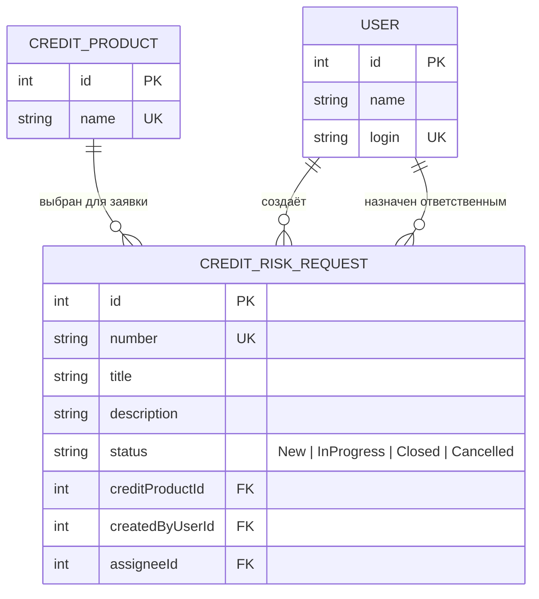

# Модель данных

## Словарь проекта

| Термин курса | Термин проекта | Комментарий |
|---|---|---|
| Ticket | CreditRiskRequest | Кредитная заявка |
| User | User | Пользователь системы |
| Site | CreditProduct | Справочник кредитных продуктов |

## ER-модель

## Справочник статусов

| Значение | Описание |
|---|---|
| `New` | Заявка создана, анализ ещё не начат |
| `InProgress` | Заявка находится на анализе |
| `Closed` | Анализ завершён |
| `Cancelled` | Дальнейшая обработка отменена |

## Проверка 3НФ

Третья нормальная форма (3НФ) означает, что таблица соответствует первой и второй нормальным формам, а неключевые атрибуты зависят непосредственно от ключа. Между неключевыми полями не должно быть транзитивных зависимостей. Поэтому данные о кредитных продуктах и пользователях вынесены в отдельные таблицы. В кредитной заявке хранятся только ссылки на них: `creditProductId`, `createdByUserId` и `assigneeId`. Название кредитного продукта и имя сотрудника не дублируются в каждой заявке.

### Таблица `CREDIT_PRODUCT`

| Атрибут | Зависимость |
|---|---|
| `id` | PK |
| `name` | зависит от `id`, уникален (UK) |

- **1НФ:** все атрибуты атомарны, первичный ключ задан.
- **2НФ:** первичный ключ простой, частичных зависимостей нет.
- **3НФ:** название продукта зависит непосредственно от его идентификатора; транзитивных зависимостей нет.

**Вывод:** таблица находится в 3НФ.

### Таблица `USER`

| Атрибут | Зависимость |
|---|---|
| `id` | PK |
| `name` | зависит от `id` |
| `login` | зависит от `id`, уникален (UK) |

- **1НФ:** все поля содержат атомарные значения.
- **2НФ:** первичный ключ простой, все неключевые атрибуты зависят от него целиком.
- **3НФ:** имя и логин не определяют друг друга; логин является альтернативным уникальным ключом.

**Вывод:** таблица находится в 3НФ.

### Таблица `CREDIT_RISK_REQUEST`

| Атрибут | Зависимость |
|---|---|
| `id` | PK |
| `number` | зависит от `id`, уникален (UK) |
| `title` | зависит от `id` |
| `description` | зависит от `id` |
| `status` | зависит от `id` |
| `creditProductId` | FK → `CREDIT_PRODUCT.id` |
| `createdByUserId` | FK → `USER.id` |
| `assigneeId` | FK → `USER.id`, может быть пустым до назначения |

- **1НФ:** все поля содержат атомарные значения.
- **2НФ:** первичный ключ простой (`id`), частичных зависимостей нет.
- **3НФ:** сведения о продукте и пользователях не дублируются в заявке, а связываются внешними ключами. `number`, `title`, `description` и `status` зависят непосредственно от `id`. Статус принимает одно из четырёх фиксированных значений курса.

**Вывод:** таблица находится в 3НФ при ограничении поля `status` указанным набором значений.

### Итоговая таблица проверки

| Таблица | 1НФ | 2НФ | 3НФ |
|---|---|---|---|
| `CREDIT_PRODUCT` | Да | Да | Да |
| `USER` | Да | Да | Да |
| `CREDIT_RISK_REQUEST` | Да | Да | Да |

**Общий вывод:** все три таблицы соответствуют 3НФ при соблюдении описанных ограничений. Разделение сущностей уменьшает дублирование данных и поддерживает целостность базы данных.

## API-контракт системы

Полное описание методов, параметров, форматов запросов и ответов приведено в файле [docs/api-contract.md](docs/api-contract.md).
