# Модель данных

## Словарь проекта

| Термин (исходный) | Термин проекта | Комментарий |
|---|---|---|
| Ticket | CreditRiskRequest | Заявка на оценку кредитного риска |
| User | User | Пользователь системы |
| RiskType | RiskType | Справочник типов риска |
| Site | Site | Площадка / объект (уточнить в домене) |

## ER-модель

```mermaid
erDiagram

    RISK_TYPE ||--o{ CREDIT_RISK_REQUEST : "определяет тип"
    USER      ||--o{ CREDIT_RISK_REQUEST : "создаёт / исполняет"

    RISK_TYPE {
        int    id   PK
        string name UK
    }

    USER {
        int    id    PK
        string name
        string login UK
    }

    CREDIT_RISK_REQUEST {
        int    id               PK
        string number           UK
        string title
        string description
        string status           "NEW | IN_PROGRESS | DONE | REJECTED"
        int    riskTypeId       FK
        int    createdByUserId  FK
        int    assigneeUserId   FK
    }
```




## Справочник статусов

| Значение | Описание |
|---|---|
| `NEW` | Создана, не назначена |
| `IN_PROGRESS` | В работе у исполнителя |
| `DONE` | Завершена |
| `REJECTED` | Отклонена |

## Проверка 3НФ

### Таблица `RISK_TYPE`

| Атрибут | Зависимость |
|---|---|
| `id` | PK |
| `name` | зависит от `id` |

- **1НФ** — все атрибуты атомарны, есть PK. ✅
- **2НФ** — нет составного PK, все неключевые атрибуты зависят от полного PK. ✅
- **3НФ** — `name` не зависит транзитивно ни от чего, кроме `id`. ✅

**Вывод:** таблица в 3НФ.

### Таблица `USER`

| Атрибут | Зависимость |
|---|---|
| `id` | PK |
| `name` | зависит от `id` |
| `login` | зависит от `id`, уникален (UK) |

- **1НФ** — атомарные атрибуты, PK есть. ✅
- **2НФ** — неключевые атрибуты зависят от полного PK. ✅
- **3НФ** — `name` и `login` не зависят друг от друга. `login` — альтернативный ключ. ✅

**Вывод:** таблица в 3НФ.

### Таблица `CREDIT_RISK_REQUEST`

| Атрибут | Зависимость |
|---|---|
| `id` | PK |
| `number` | зависит от `id`, уникален (UK) |
| `title` | зависит от `id` |
| `description` | зависит от `id` |
| `status` | зависит от `id` |
| `riskTypeId` | FK → `RISK_TYPE.id` |
| `createdByUserId` | FK → `USER.id` |
| `assigneeUserId` | FK → `USER.id` |

- **1НФ** — атомарные атрибуты. Поле `status` хранит строку, допустимо при ограничении enum на уровне БД/приложения. ✅
- **2НФ** — PK простой (`id`), все неключевые атрибуты зависят от полного PK. ✅
- **3НФ** — транзитивных зависимостей нет: `riskTypeId` и `createdByUserId`/`assigneeUserId` — FK, данные не дублируются в заявке; `number` зависит только от `id`. Справочник статусов не вынесен в отдельную таблицу, что не нарушает 3НФ при фиксированном enum. ✅

**Вывод:** таблица в 3НФ при условии, что `status` ограничен фиксированным enum.

### Итоговая таблица проверки

| Таблица | 1НФ | 2НФ | 3НФ |
|---|---|---|---|
| `RISK_TYPE` | ✅ | ✅ | ✅ |
| `USER` | ✅ | ✅ | ✅ |
| `CREDIT_RISK_REQUEST` | ✅ | ✅ | ✅ |

**Общий вывод:** модель находится в 3НФ.

## API-контракт системы

```text
docs/api-contract.md

GET    /api/v1/credit-risk-requests
GET    /api/v1/credit-risk-requests/{id}
POST   /api/v1/credit-risk-requests
PATCH  /api/v1/credit-risk-requests/{id}/assignee
PATCH  /api/v1/credit-risk-requests/{id}/status
```
