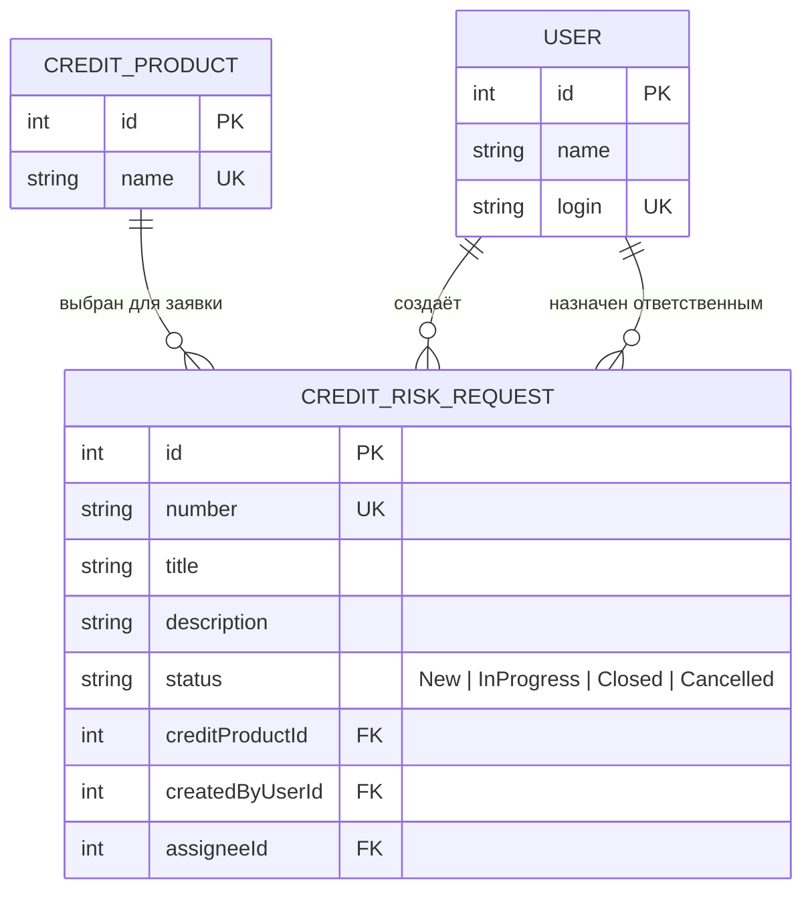

# Модель данных

## Словарь проекта

| Термин курса | Термин проекта | Комментарий |
|---|---|---|
| Ticket | CreditRiskRequest | Кредитная заявка |
| User | User | Пользователь системы |
| Site | CreditProduct | Справочник кредитных продуктов |

## ER-модель

## Справочник статусов

| Значение | Описание |
|---|---|
| `New` | Заявка создана, анализ ещё не начат |
| `InProgress` | Заявка находится на анализе |
| `Closed` | Анализ завершён |
| `Cancelled` | Дальнейшая обработка отменена |

## Проверка 3НФ

Третья нормальная форма означает, что неключевые атрибуты зависят непосредственно от ключа таблицы. Сведения о кредитных продуктах и пользователях вынесены в отдельные таблицы, поэтому в заявке хранятся ссылки на них, а не повторяющиеся названия и имена.

### CREDIT_PRODUCT

- `id` — первичный ключ.
- `name` — название продукта, зависит от `id` и уникально.

Все поля атомарны, первичный ключ простой, транзитивных зависимостей нет. Таблица соответствует 3НФ.

### USER

- `id` — первичный ключ.
- `name` — имя пользователя.
- `login` — уникальный логин.

Все поля атомарны. Неключевые атрибуты зависят от первичного ключа, транзитивных зависимостей нет. Таблица соответствует 3НФ.

### CREDIT_RISK_REQUEST

- `id` — первичный ключ.
- `number` — уникальный номер заявки.
- `title`, `description`, `status` — данные заявки.
- `creditProductId` — внешний ключ на `CREDIT_PRODUCT.id`.
- `createdByUserId` — внешний ключ на `USER.id`.
- `assigneeId` — внешний ключ на `USER.id`, может быть пустым до назначения аналитика.

Поля атомарны, первичный ключ простой. Сведения о продукте и пользователях не дублируются в заявке. Таблица соответствует 3НФ при использовании заданного набора статусов.

## API-контракт

Методы и форматы обмена описаны в [docs/api-contract.md](api-contract.md).
